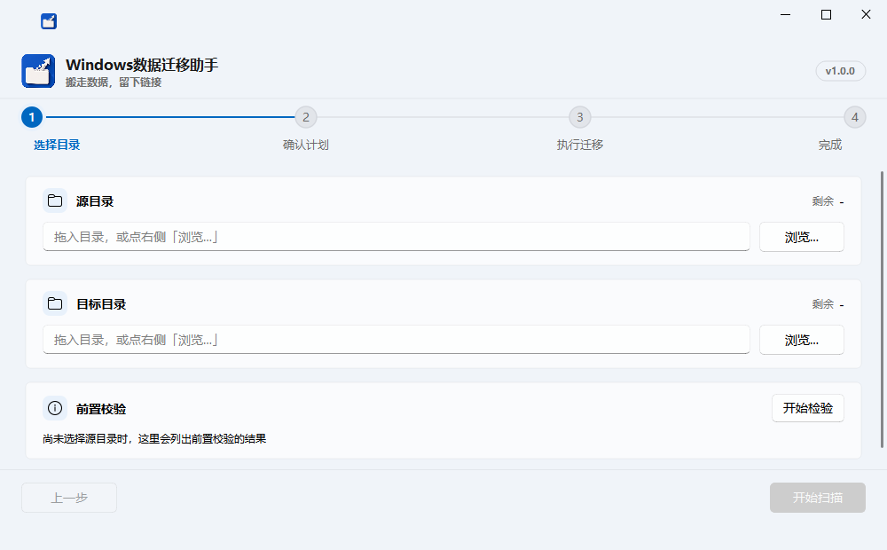
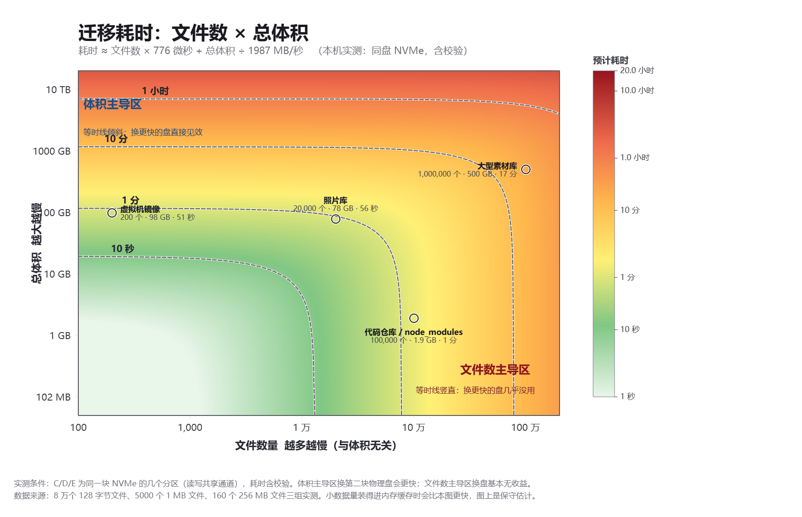

# Windows数据迁移助手

把占空间的数据目录整棵搬到其他盘，并在原路径留下链接，让程序继续照常访问。

> 搬走数据，留下链接。


[](../../releases/latest)




## 三步上手

1. 到 [Releases](../../releases/latest) 下载 zip，解压
2. 双击 `Windows数据迁移助手.exe`
3. 选源目录和目标目录 → **点「开始检验」** → 一路下一步

**第二步里那次「开始检验」别跳过。** 它用一次几毫秒的试探改名，提前回答「现在有没有程序占着源目录」——
这是唯一一个会等到最后一步才炸的错误：复制校验全跑完、你已经等了几个小时，才卡在改名上。

## 下载

| 从哪下 | 地址 |
|---|---|
| 官方 | [Releases](../../releases/latest) |
| 国内镜像 | 直连 GitHub 在国内经常超时，在地址前加 `https://gh-proxy.com/` 即可：<br>`https://gh-proxy.com/https://github.com/vibe-weaver/windows-data-migrator/releases/download/v1.0.0/windows-data-migrator-1.0.0-win64.zip` |

解压后双击里面的 `Windows数据迁移助手.exe`（文件夹名是中文的，zip 名是 ASCII 的——中文文件名在镜像站和下载工具里容易出问题）。

**绿色免安装**：不写注册表，删掉文件夹就是卸载。

详细用法见压缩包里的 **`使用说明书.html`**（双击用浏览器打开）。

> ### ⚠️ 装了 Windows Defender 的，先看这条
>
> **现在下载解压后，Defender 会把 `Windows数据迁移助手.exe` 直接删掉。** 这是**误报**：
> 检测名 `Trojan:Win32/Bearfoos.B!ml`，`!ml` 后缀表示这是**机器学习启发式判定**，
> 不是特征码命中。触发它的很可能是本工具的行为画像（遍历目录树、给目录改名、
> 建 junction、关闭占用进程）——而这些操作每一步都可见、有日志、可回退。
>
> 已经提交微软误报申诉（2026-10-14），等白名单生效期间可以这样绕过：
>
> ```powershell
> # 管理员 PowerShell：解压前先排除目标文件夹，否则解压出来立刻被删
> Add-MpPreference -ExclusionPath 'D:\你解压到的目录'
> ```
>
> 或者解压后从 **Windows 安全中心 → 病毒和威胁防护 → 保护历史记录** 里把它还原，
> 再添加排除项。白名单通过后建议删掉排除项：
> `Remove-MpPreference -ExclusionPath 'D:\你解压到的目录'`
>
> 想先核对程序到底做了什么，源码就在仓库里；也可以用 `packaging/build.ps1` 自行构建。

## 它和「剪切粘贴」「手动 mklink」的区别

| 做法 | 问题 |
|---|---|
| 剪切粘贴到别的盘 | 原路径没了，任何按原路径找数据的程序立刻报错 |
| 手动 `mklink /J` | 得先复制、再改名、再建链接，中途失败就两头不着；而且**会顺手把链接指向的远端仓库数据也复制一遍** |
| **本工具** | 复制 → **逐个文件校验** → 改名 → 建链接，四步都可回退；树里的链接只重建链接本身，不搬远端数据 |

## 先读这段：它会动你的数据，也会关你的程序

这个工具做的事（复制整棵树、给目录改名、建 junction、关闭占用文件的进程）**和恶意软件的行为特征重合**，
所以先把边界说清楚：

- **它只碰你选的那一个源目录，以及你指定的目标目录。** 不读注册表、不联网、不收集任何信息。
- **全程可回退。** 复制完成并校验通过之后，源目录才会被改名成「备份」；任何一步失败，源目录原样不动。
  备份还在，就能一键回滚。
- **它不删除任何数据**，除非你明确点了「删除备份」并二次确认——那一步会单独警告「删掉之后无法再回滚」。
- **关闭进程走的是系统官方通道**（和安装程序让你「关闭以下程序以继续」同一个机制），
  程序会走正常退出流程、该提示保存的会提示保存。**只有「强制结束」会丢未保存内容，而它需要单独确认。**
- **系统关键进程、桌面外壳、安全软件、工具自己，一律不关**，并且会写明理由请你手动处理。

源码在仓库里，可以直接核对上述任何一条。

## 界面总览

四步向导：**选择目录 → 确认计划 → 执行迁移 → 完成**

- **选择目录**：源与目标支持拖拽，显示两个卷的剩余空间。**必须先点「开始检验」**——
  它会用一次几毫秒的「试探改名」提前回答「现在有没有程序占着源目录」，
  而这是唯一一个会等到最后一步才炸的错误。检验出红色错误会禁止进入下一步。
- **找出占用进程**：检验因改名被挡而失败时，多出一个入口。它会先缩小范围（只试探子目录，
  实测比逐个试探文件快得多），再问系统「谁占着」，列出进程名、PID、完整可执行路径，
  并标出哪些**不会**由工具关闭及其理由。
- **确认计划**：真实数据量、文件数、目录数、链接数、需提权目录、预计耗时；链接目标归位表
  可逐条填写「重写为」的新路径；非链接类重解析点与复制选项各自成卡。
- **执行迁移**：总进度、当前文件、速度、剩余时间、滚动日志；可暂停/取消；失败清单带占用进程。
- **完成**：统计、未完成清单、导出 CSV、重新校验、删除目标、一键回滚、删除备份。
  **回滚成功之后这一页会切换成「恢复结果」**——那件事已经被撤销了，继续顶着「迁移成功」是错的。

## 迁移流程

```
检验 → 预扫描 → 复制 → 校验 → 源目录改名为备份 → 建立链接 → 确认后删除备份
```

校验不通过**绝不删除源目录**；任何一步失败都可以回滚。

## 多久能搬完

**耗时主要由文件数量决定，不是数据量。**



| 总大小 ＼ 文件数 | 1,000 | 10,000 | 100,000 | 1,000,000 |
|---|---:|---:|---:|---:|
| **1 GB** | 1 秒 | 8 秒 | 1 分 | 13 分 |
| **10 GB** | 6 秒 | 13 秒 | 1 分 | 13 分 |
| **100 GB** | 52 秒 | 59 秒 | 2 分 | 14 分 |
| **1000 GB** | 9 分 | 9 分 | 10 分 | 22 分 |
| **9 TB** | 1.4 小时 | 1.4 小时 | 1.5 小时 | 1.6 小时 |

图怎么读：等时线**斜着**的那部分是「体积主导」，换更快的盘直接见效；**拐成竖线**的那部分是
「文件数主导」，瓶颈不在带宽——时间都花在「一个个打开、写、关闭、记时间戳」这套每个文件都要
走一遍的固定动作上。所以**同类硬盘之间换盘基本没用**（NVMe 换更快的 NVMe 白花钱），
但**机械盘换 SSD 会大幅见效**（寻道让每文件的元数据操作慢十倍以上）。
同样 100 GB：10 万个文件要 2 分钟，100 万个文件要 14 分钟。

顺带两个「不挂钩」的因素：数据**装得进内存**时会比图上更快（实测 5 GB 的 1 MB 文件用 5.51 秒，
模型算 6.4 秒）；开了 SHA256 全量校验后瓶颈变成 **CPU 哈希**（1.7 GB/秒，与磁盘无关）。

<details>
<summary>这些数字是怎么来的</summary>

模型 `耗时 ≈ 文件数 × 776 微秒 + 总体积 ÷ 1987 MB/秒`，两个参数都由实测反推
（8 万个 128 字节文件、5000 个 1 MB 文件、160 个 256 MB 文件三组真实迁移），
耗时**含校验**。实测环境是同一块 NVMe 上的几个分区（读写共享通道）；
数据装得进内存缓存时会比图上更快，所以图上是**保守估计**。
重画用 `docs/figures/draw-performance-map.py`。
</details>

## 特性

- **正确处理嵌套软连接**：目录里的 junction / 符号链接只在目标端重建链接本身，不把远端仓库（如 pnpm、npm 缓存）的数据复制过来
- **链接目标重写**：相对路径原样保留；指向源树内部的绝对路径自动改写为新位置；指向树外的保留，并给出归属报告让你决定是否映射。填写的重写在重新扫描后依然保留，不会被悄悄丢掉
- **非链接类重解析点不丢**：云占位符、AppExecLink、Dedup 这类默认按真实内容复制（`open()` 都打不开的原样搬重解析数据），也可显式跳过；跳过时删备份前会拦一道，因为它们只存在于备份里
- **续传只认自己复制过的**：跳过判定 = 会话记账 + 大小与时间戳精确核对。目标盘上别人的同大小残留一定会被真实内容覆盖，不会被当成「已复制」放过。
  失败后 `resume`（以及界面「以管理员身份重试」的重启）沿用同一份记账接着跑，不再从头复制一遍；源或目标换过则拒绝沿用——记账里是相对路径，换一棵树沿用等于把不相干的文件当成已复制而跳过
- **默认校验比大小 + 时间戳**：同大小、内容不同的残留会被抓出来；可选 SHA256 全量校验。
  校验阶段有进度、可取消；取消或不通过都不会动源目录
- **权限不足提前说**：预扫描就列出无权限路径；计划里有文件符号链接而当前进程建不出来时，
  计划页当场提示并给出「以管理员身份重试」，不用等复制几小时后才发现
- **无权限目录不再是死路**：拿不到权限时有两条出路——提权后「接管这些目录的权限」
  （或 `--take-ownership`，接管前先把原始 ACL 存进会话，回滚时按记录还原），
  或者直接排除掉（`--exclude` / 勾选「跳过无权限访问的目录」）。被排除的内容不会
  复制到目标、只存在于备份里，所以删备份会被拦住
- **卷层面的问题提前说清**：具体严重度分三档——**源所在卷不支持 junction
  （如 FAT/exFAT）是硬错误**，它意味着最后一步无法在原路径留下入口，而那时
  数据已经搬走，比复制失败难收拾得多；**目标卷不支持 junction** 只在源树内
  真有链接要重建时才是硬错误，否则仅警告；源与目标同卷（搬了不省空间、备份还与
  原件同盘）、源或目标是可移动盘/网络盘则只作**警告不阻断**——同卷等价于跨目录
  搬家，用户常常是有意为之。这些都会在计划页和命令行里说清楚
- **断链看得见**：目标在迁移前就不存在的链接仍会原样重建，但会在计划页、计划 JSON、
  报告（标红）里列出来——否则用户会以为是迁移把链接弄坏了
- **目标端的每个链接都核对**：改名之前逐条比对重建出来的链接指向是否等于计划要求，
  指错了就停下（源目录原样未动），而不是等用户某天点开那条链接才发现
- **目录时间戳也复制**：目标端目录的 mtime 与源一致，依赖目录时间戳做增量同步或
  缓存失效判断的工具不会整棵重扫
- **保不住的属性会说明**：稀疏文件会实化、硬链接会变成各自独立的副本——
  这两样复制不会报错，结果却与原件不同，因此在计划页、命令行与报告里都会给出条数。
  附加数据流（ADS，下载文件的 `Zone.Identifier`）**会随内核复制一并保留**，不再
  属于「丢失」项；仍然报条数，是因为迁移后这些信息还活着，某些安全软件会据此做隔离判断。
  ADS 探测要对每个文件问一次文件系统（几十万文件下是可测的常数开销），
  可用 `--no-ads-scan` 关掉；关掉时计划里会明确标成「没探测过」而不是 0
- **每趟留一份运行日志**：与会话同目录的 `<会话>.log`，带时间戳记下本次参数、
  扫描结论、复制/校验计数与失败项、备份路径、最终结果，以及回滚/删备份这类
  破坏性动作。失败现场往往已经变了（源被改名成备份、目标端着半成品），
  复盘全过程只能靠它；命令行与报告页都会把日志路径显示出来
- **「重新校验」不比目标自己**：迁移成功后源路径已是指向目标的链接，此时拿备份当原件比对；
  备份也删了就如实说「没有可比对的原件」，绝不返回一个假的通过
- **破坏性动作先确认**：回滚（迁移后写进目标的新数据会变成孤儿）、删备份（最后一份副本）、
  迁移中关窗（已复制的内容会保留、之后可以续传）都会先说清后果再执行
- **致命错误不空转**：磁盘写满、缺符号链接特权这类重试也没用的错误立即整体停止并说清下一步，
  不再逐个文件白等 14 秒（10 万个文件就是约 389 小时）
- **文件被占用不放弃**：自动重试并查出占用进程（进程名 + PID，双击可定位）
- **改名失败有诊断也有出口**：源目录改名成备份会先退避重试，仍失败则列出正占着源目录的进程；
  此时源目录原样未动，目标端的半成品可以一键删除
- **长路径安全**：全程 `\\?\` 前缀，`node_modules` 这类深层目录不会失败

## 开发时运行

```powershell
& '.\env\Scripts\python.exe' app.py
```

打包好的成品直接双击 `dist\Windows数据迁移助手\Windows数据迁移助手.exe`。

```powershell
& '.\env\Scripts\python.exe' app.py
```

四步向导：

1. **选择目录**——源目录、目标目录（支持拖拽），实时显示两个卷的剩余空间与前置校验结果
2. **迁移计划**——真实数据量、文件数、目录数、链接数、需提权目录数、预计耗时；
   链接目标归属表列出所有指向源树之外的链接，可逐条填写「重写为」的新路径后
   点「应用映射并重新扫描」（填过的值重扫后仍在）；非链接类重解析点单列一张清单，
   默认按真实内容复制，勾选后改为跳过
   - 无权限目录有两处出口：「以管理员身份重试」（提权），提权后仍读不到的可以点
     「接管这些目录的权限」，或者勾选「跳过无权限访问的目录」把它们排除掉
   - 摘要里会点出断链条数、以及复制保不住的属性（稀疏 / 硬链接 / ADS）条数
3. **执行迁移**——总进度、当前文件、速度、剩余时间、滚动日志；可暂停/取消；
   复制与校验两个阶段都显示进度（计数行前缀「复制中」/「校验中」），校验也能取消；
   失败清单显示占用进程名与 PID，双击可定位
4. **结果报告**——成功/失败/跳过统计、未完成清单、导出 CSV、一键回滚、删除备份，
   以及这趟运行的日志路径（与会话同目录的 `<会话>.log`）；
   迁移没走完且没生成备份时（源目录完好、目标端留着半成品）还会出现「删除目标」

启动参数：

- `--elevated`——由「以管理员身份重试」自动带上，无需手输
- `--session <id>`——恢复指定会话（提权重启时用于把任务带回界面）

## 打包

```powershell
pwsh -File packaging\build.ps1          # 只出图形界面版
pwsh -File packaging\build.ps1 -Cli     # 额外出一个命令行版
```

产物在 `dist\`：

- `Windows数据迁移助手\`——**onedir** 的图形界面版（`--onefile` 每次启动都要把 111 MB
  解压到 `%TEMP%`、实测启动要 6.9 秒，改成 onedir 后是 1.1 秒）。exe 内嵌 `asInvoker`
  清单，双击不弹 UAC
- `Windows数据迁移助手-cli.exe`——加 `-Cli` 时才有；`--windowed` 的 exe 没有控制台，
  想在终端里用子命令请用这个版本
- 打包时自动附上 `使用说明书.html`

构建用 `--optimize 2`：**剥掉全部文档字符串**。本项目的文档字符串写得很详细（含设计理由与
实测数字），不打这个开关等于把开发笔记一起发出去。实测产物里 30 个模块有 28 个带着
文档字符串、约 2.8 万字符，加了这个开关之后一段都不剩。

> 需要说明的是，它**不是代码保护**——字节码照样能反编译。它降低的是「随手一看就看到
> 全部设计笔记」的门槛，不是加密。

## 命令行用法

```powershell
# 只看计划，不动任何数据
python app.py scan --source D:\myapp\data --target E:\myapp\data

# 执行迁移
python app.py migrate --source D:\a --target E:\b --yes

# 联动迁移：重写链接指向到新位置（外部仓库需自行提前/另行迁移到新位置）
# --map 只改写链接目标，不会搬运外部仓库的数据；映射到尚未迁移的位置会让链接变断链
python app.py migrate --source D:\a --target E:\b --yes ^
  --map "C:\Users\me\AppData\Local\npm-cache=E:\npm-cache"

# 启用逐文件哈希校验
python app.py migrate --source D:\a --target E:\b --yes --sha256

# 跳过云占位符 / AppExecLink 等非链接类重解析点（默认按真实内容复制）
# 注意：跳过后它们只存在于备份里，删除备份会被拦住，需要再确认一次
python app.py migrate --source D:\a --target E:\b --yes --skip-unknown-reparse

# 不探测附加数据流（ADS），扫描更快；计划里会标成「没探测过」而不是 0
python app.py migrate --source D:\a --target E:\b --yes --no-ads-scan

# 跳过某些目录（可重复）。跳过的内容不会复制到目标、只留在备份里，删备份会被拦住
python app.py migrate --source D:\a --target E:\b --yes ^
  --exclude "D:\a\locked" --exclude "D:\a\cache"

# 以管理员身份运行时，接管无权限目录的属主（会先把原始 ACL 记进会话，回滚时还原）
python app.py migrate --source D:\a --target E:\b --yes --take-ownership

# 迁移中途失败后，从会话文件继续（已复制且未被改动的文件直接跳过）
python app.py resume %LOCALAPPDATA%\DataMigrationTool\sessions\<id>.json --yes

# 退回迁移前的状态。注意：迁移之后写进目标端的新数据会变成孤儿
python app.py rollback %LOCALAPPDATA%\DataMigrationTool\sessions\<id>.json --yes

# 迁移中途失败后，清掉目标端的半成品（源目录不受影响）
# 源目录已经是指向目标的链接时会拒绝执行——那时目标端就是活数据
python app.py discard %LOCALAPPDATA%\DataMigrationTool\sessions\<id>.json --yes
```

失败时命令行会直接给出下一步：`dmig resume <会话文件>` 续传，或
`dmig discard <会话文件> --yes` 清掉半成品。

`scan` 同样接受 `--exclude`；计划 JSON 里会给出 `excluded`（实际跳过的条目）、
`dangling_links`（断链）与 `lossy_attributes`（保不住的属性计数）。

## 常见问题

<details>
<summary><b>迁移到一半取消了，白干了吗？</b></summary>

没有。已完成的文件都记在会话里（`%LOCALAPPDATA%\DataMigrationTool\sessions\`），
重新选中同一个会话会从断点继续，已完成且未改动的文件直接跳过。
</details>

<details>
<summary><b>怎么判断备份能不能删？</b></summary>

判据是「你是否确定不再需要退回迁移前的状态」，**不是「是否已经手动验证过」**。
回滚必须依靠备份文件，删掉就再也回不去了。报告页顶部有一条常驻警告写着备份路径。
</details>

<details>
<summary><b>它提示「改不了名，但查不出占用者」，是怎么回事？</b></summary>

有程序把**源目录本身**当工作目录了——资源管理器开着那个文件夹，或者某个终端 `cd` 在里面。
这类占用挡得住改名，但系统接口拿不到那个进程。手动关掉那些窗口再重新扫描即可。
</details>

<details>
<summary><b>目标盘上已经有同名文件怎么办？</b></summary>

按「合并/续传」处理：已完成且大小与时间戳一致的文件跳过，其余覆盖。
目标端**不属于这次迁移**的内容不会被删——回滚时清目标端也会先检查这一点。
</details>

<details>
<summary><b>杀毒软件报毒怎么办？</b></summary>

**已确认会误报，而且是最麻烦的一种：Windows Defender（系统自带）会直接删掉 exe。**

```
检测名   Trojan:Win32/Bearfoos.B!ml        严重度 5
判定方式 机器学习启发式（!ml 后缀），不是特征码命中
后果     解压出来的 exe 被隔离，双击时报「找不到文件」
```

原因是这个组合触发了启发式：**PyInstaller 打包 + 无数字签名 + 遍历目录树 / 改名目录 /
建 junction / 关闭进程**的行为画像。已提交微软误报申诉（2026-10-14，等白名单）。

**绕过办法**（解压前就做，否则文件落地即被删）：

```powershell
# 管理员 PowerShell
Add-MpPreference -ExclusionPath 'D:\你解压到的目录'
```

解压后才发现被删的，去 **Windows 安全中心 → 病毒和威胁防护 → 保护历史记录** 还原，
再添加排除项。白名单通过后用 `Remove-MpPreference -ExclusionPath '...'` 删掉它。

**这个工具不会碰你选定的目录以外的任何东西** ✗ —— 不读注册表、不联网、不收集信息；
关闭进程走系统官方的 RestartManager，且拒绝关闭系统关键进程、桌面外壳、安全软件和它自己。
源码就在仓库里，可以直接核对；也可以用 `packaging/build.ps1` 自行构建（自行构建的副本
哈希不同，同样可能被误报 ✗ 但至少你知道它是什么）。
</details>

<details>
<summary><b>还有哪些限制？</b></summary>

- **目录句柄占用查不出进程**：见上
- **稀疏文件会变实占**：动态 VHD 这类文件复制到目标端会占用完整大小（计划页的空间需求按逻辑大小算，与之一致）
- **同盘迁移不释放空间**：源与目标同卷时会有黄色警告
- 完整清单见压缩包里的 `使用说明书.html`
</details>

## 开发

```powershell
& '.\env\Scripts\python.exe' -m pip install -i https://mirrors.aliyun.com/pypi/simple/ -r requirements.txt
& '.\env\Scripts\python.exe' -m pytest -q
```


